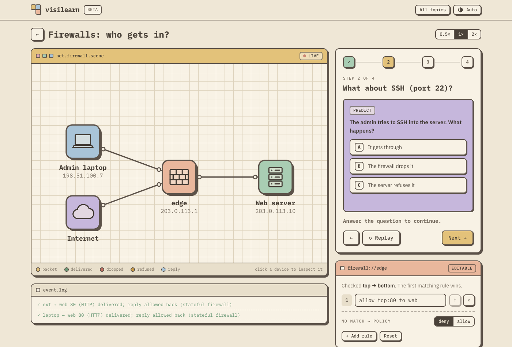
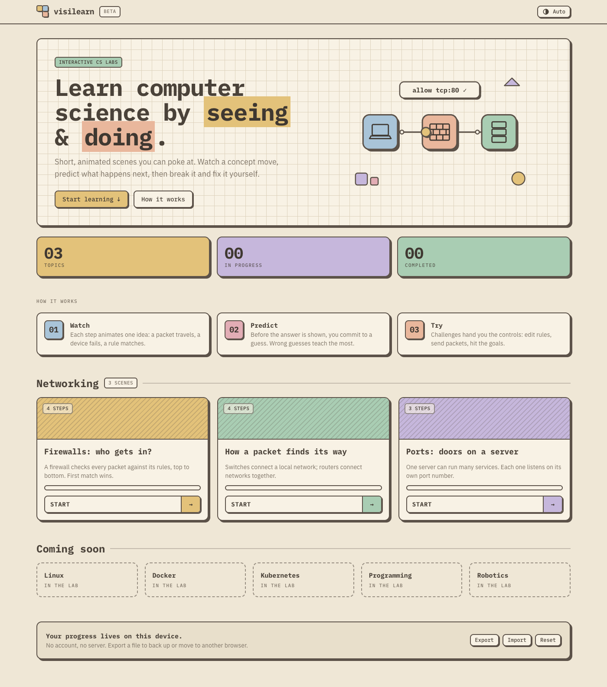
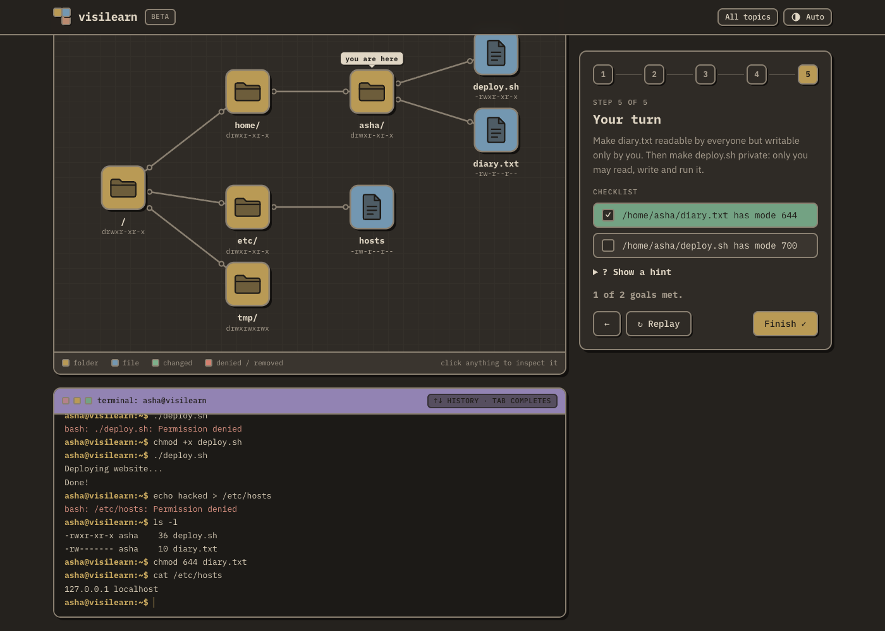
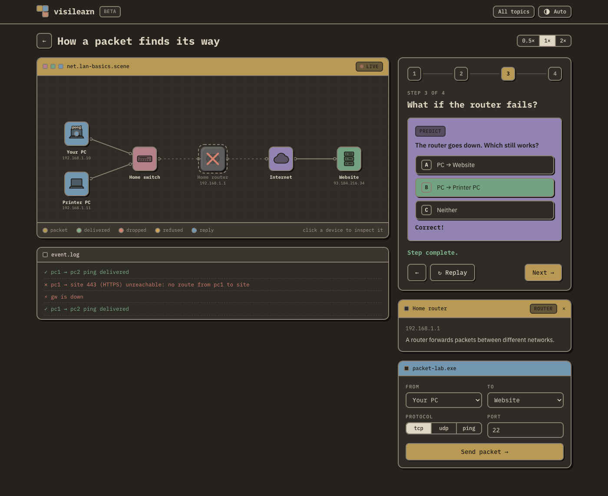
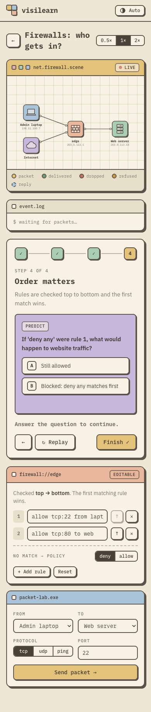

# visilearn

**Learn computer science by seeing and doing.**

visilearn is a visual, interactive learning platform for students and working professionals.
Concepts such as firewalls, routing, the Linux command line, Docker and Kubernetes are taught through short
animated scenes you can poke at. You watch a concept move, **predict** what happens next, then
take the controls and solve a challenge.

Every lesson is a small text file written in a purpose-built **scene language**. One shared
engine turns these files into animated, interactive SVG with real simulators behind them, so a
new concept never needs its own hand-built tool. Lessons are short enough for an AI to write
cheaply and for a human expert to review as a plain text diff.

<p align="center">
  
</p>

| Catalog | Linux terminal (dark) | Networking (dark) | Phone |
|---|---|---|---|
|  |  |  |  |

---

## Contents

- [Why visilearn](#why-visilearn)
- [Features](#features)
- [Tech stack](#tech-stack)
- [Quick start](#quick-start)
- [How a lesson is written](#how-a-lesson-is-written)
- [Architecture](#architecture)
- [AI-assisted authoring with MCP](#ai-assisted-authoring-with-mcp)
- [Design system](#design-system)
- [Development workflow (TDD)](#development-workflow-tdd)
- [Deploying to Firebase Hosting](#deploying-to-firebase-hosting)
- [Adding a new topic pack](#adding-a-new-topic-pack)
- [Roadmap](#roadmap)

---

## Why visilearn

| Problem | visilearn's answer |
|---|---|
| Textbooks and videos are passive. | Every step is interactive. Learners predict, experiment and get instant feedback. |
| Interactive simulations are expensive to build, often one tool per concept. | One **universal engine** and many tiny lesson files. Topic areas plug in as **packs**. |
| Diagram tools (Mermaid, draw.io) show structure but not behaviour. | Scenes have **simulators**: packets are routed, firewalls evaluate rules, devices fail. |
| AI-generated content is hard to trust. | The language is strict and validated. Outcomes are *computed*, never hand-written, and lessons are reviewed as ~30-line text diffs. |
| Hosting and accounts add cost and friction. | A fully **static site** with **no database**. Progress stays on the learner's device. |

## Features

**For learners**

- **Animated scenes.** Packets travel, firewalls drop traffic, routers fail, and the colour of the outcome is revealed on arrival.
- **Predict → observe → explain.** Questions pause the animation until you commit to an answer.
- **Hands-on challenges.** Edit the firewall rules live, send any packet from the *packet lab*, and complete a checklist that the simulator grades.
- **A real-feeling Linux terminal.** Type commands and watch the filesystem tree react: the *you are here* badge moves on `cd`, files appear and disappear, and permissions update live. It has history (↑ ↓) and Tab completion, and a simulated filesystem with users, permissions, `sudo`, pipes and redirects.
- **Click any device** to learn what it does.
- **Progress saved on your device.** You resume at the first unfinished step, and your rule edits are remembered. Export/Import a JSON file to back up or switch browsers.
- **Light, dark and Auto themes**, a phone-friendly layout, keyboard navigation (← →), a reduced-motion setting and screen-reader labels.

**Modules: share lessons without a server**

- Bundle lessons into a **module**, save it in **My modules** on your device, **export** it as a `.visilearn.json` file, or **share a link** that contains the whole module.
- Anyone can **import** a module from a file (picker or drag-and-drop) or by opening a link. They review it, then add it.
- Modules contain lesson text only (no code), checked by the same compiler as built-in lessons, so opening one from a stranger is low-risk. Format: [docs/MODULES.md](docs/MODULES.md). Try `examples/modules/starter.visilearn.json`.

**AI models: local first**

- **AI models** screen (`#/settings`): connect **Ollama** (default), **LM Studio**, **llama.cpp server**, any **OpenAI-compatible** server, or **OpenAI**.
- **Test connection** explains exactly what's wrong: server not running, the browser blocked by CORS (with a copyable `OLLAMA_ORIGINS` command for your site), or the model not installed (`ollama pull …`).
- Try a prompt (streamed) and check structured JSON output. Verified with `gemma4:12b` on Ollama.
- API keys stay in this browser only and are never exported.

**Studio: turn your own files into a module (local AI first)**

- Open **Studio**, pick PDFs, Markdown or text files (read in your browser, never uploaded), and tick the chapters you want.
- The AI designs a **topic pack** (or you reuse a built-in one), plans the lessons (you edit the plan), and writes each lesson.
- Every draft is compiled and **simulated**: a challenge that can't be solved, or is solved before the learner acts, is sent back to the model with the exact errors until it's fixed.
- Review, edit the source with live validation, **Save & preview**, then share it like any module. Sources and page ranges are recorded.
- Works with Ollama out of the box. It was tested live with `gemma4:12b` on the sample Git book, and the tests guard against the quirks we found in small local models.

**Open pack system: new topics without code**

- Topic vocabularies (*packs*) are not a fixed list. Besides the built-in packs, a **data pack** written in the pack definition language adds kinds of things (with icons, colours and properties) and **macros**. For example, a `git` pack provides `commit c3 c2 main` and `merge m1 c2 f1 main`.
- Data packs travel **inside modules**, so importing a module brings its vocabulary along. The Studio will generate them from your books. They are pure data, never code, so they are safe to share.
- The built-in **`concept`** pack provides generic building blocks for any subject (`add`, `connect`, `point`, `set`, `flow`, `mark`, …), and learners can press **buttons** to act on the scene.
- Try `examples/modules/git-basics.visilearn.json`: a Git module that carries its own `git` pack.

**For authors**

- A **token-efficient scene language**: no coordinates (layout is automatic), line-based syntax, domain vocabulary.
- **Validator errors with fixes**, e.g. `L7: unknown action 'sendd' (did you mean 'send'?)`.
- **Headless simulation**: run any lesson without a browser to check every outcome.
- An **MCP server** so any AI assistant can draft, validate, simulate and save lessons.

## Tech stack

| Layer | Technology | Why |
|---|---|---|
| Language | **TypeScript** 5 (strict) | One codebase for the engine, UI, tests and MCP server. Node runs the `.ts` files directly through type stripping, so there's no build step for tools. |
| UI behaviour | **Alpine.js** 3 | Small, declarative, lives in the HTML. Bundled and minified by Vite. |
| Styling | **Tailwind CSS** 4 (`@tailwindcss/vite`) | Design tokens as CSS variables, so light and dark only swap values. Output is purged and minified with Lightning CSS. |
| Graphics | **Hand-written animated SVG** | Crisp at any size, themeable via CSS, accessible DOM, and no Rive/canvas runtime. |
| Fonts | **IBM Plex Mono / Sans** (self-hosted via `@fontsource`) | The retro mono look, and works offline. |
| Build / dev server | **Vite** 6 | Fast HMR. Lesson files are bundled at build time. |
| Unit tests | **`node:test`** (built-in) | Zero-dependency, fast, runs the TypeScript directly. |
| End-to-end tests | **puppeteer-core** + your installed Chrome | Drives the real UI: answers questions, edits rules, checks themes and the phone layout. |
| AI authoring | **Model Context Protocol** (`@modelcontextprotocol/sdk`, `zod`) | A local stdio server any MCP client can use. |
| Hosting | **Firebase Hosting** (static) | No backend, no database. |
| Storage | **`localStorage`** | Progress and theme are per device, with JSON export/import as backup. |

Production bundle: about **37 KB JS + 8 KB CSS gzipped** (Alpine included), plus fonts.

## Quick start

Requires **Node.js 23.6 or newer** (it runs TypeScript directly; developed on Node 26).

```bash
git clone https://github.com/subhn23/visilearn.git
cd visilearn
npm install

npm run dev          # http://localhost:5173  (live reload)
```

| Command | What it does |
|---|---|
| `npm run dev` | Start the dev server |
| `npm test` | Unit tests (engine, view models, scenes) |
| `npm run test:watch` | Unit tests in watch mode, for the TDD loop |
| `npm run check` | Validate + simulate every lesson (`-- -v` for a step-by-step report) |
| `npm run build` | Type-check and build the minified site into `dist/` |
| `npm run test:live` | Live tests against your local Ollama (skipped if it isn't running) |
| `npm run e2e` | Browser tests against the built site (run `npm run build` first; set `CHROME_PATH` if Chrome isn't in the default macOS location) |
| `npm run mcp` | Start the authoring MCP server (stdio) |
| `npm run deploy` | check → test → build → `firebase deploy --only hosting` |

## Topics available now

| Track | Lessons |
|---|---|
| **Networking** (`net`) | Firewalls: who gets in? · How a packet finds its way · Ports: doors on a server |
| **Linux** (`linux`) | Finding your way around · Permissions: who can do what? · Pipes: small tools, big results |

## How a lesson is written

Lessons live in `scenes/<pack>/<name>.scene`. Here is the full firewall lesson:

```
scene net.firewall "Firewalls: who gets in?"
about "A firewall checks every packet against its rules, top to bottom. First match wins."
use net

host laptop 198.51.100.7 label="Admin laptop"
internet ext label="Internet"
fw edge 203.0.113.1
server web 203.0.113.10 port=80,22 label="Web server"

link laptop edge web
link ext edge

rules edge editable policy=deny
  allow tcp:80 to web

step "Anyone can open the website (port 80)"
  say "Rule 1 on the firewall allows TCP port 80 to the web server, from anywhere."
  laptop send web:80
  ext send web:80

step "What about SSH (port 22)?"
  ask "The admin tries to SSH into the server. What happens?" "It gets through" "The firewall drops it" "The server refuses it" answer=2
  laptop send web:22
  note edge "No rule matched → default policy: deny"

step "Challenge: let only the admin SSH in"
  say "Edit the firewall rules on the right. Use the packet lab to test your idea."
  hint "Add a rule like: allow tcp:22 from laptop to web"
  goal laptop->web:22 ok, ext->web:22 blocked, ext->web:80 ok
```

What makes the language cheap to write and easy to review:

1. **No coordinates.** The engine lays out the diagram automatically (clients on the left, servers on the right).
2. **Line-based, not JSON/YAML.** Fewer tokens and fewer syntax mistakes.
3. **Domain words carry meaning.** `fw`, `send` and `kill` each come with a built-in look, animation and behaviour.
4. **Outcomes are computed.** Whether a packet is delivered, dropped, refused or unreachable comes from the simulator, and so do goals.
5. **Strict grammar with helpful errors.** An AI can fix a mistake in one round trip.

A Linux lesson declares its whole filesystem as one indented tree:

```
scene linux.navigate "Finding your way around"
use linux

fs as=asha
  home/
    asha/
      notes.txt "buy milk"
      projects/
  etc/
    hosts "127.0.0.1 localhost"

step "Where am I?"
  run pwd
step "Your turn"
  say "Go to /etc and print the hosts file."
  goal cwd /etc, ran cat, output "localhost"
```

The friendly guide is **[docs/LANGUAGE.md](docs/LANGUAGE.md)**. The normative, versioned
specification is **[docs/GRAMMAR.md](docs/GRAMMAR.md)**: a formal EBNF covering the lexical rules,
the document structure, steps, and every pack. A test keeps it in sync with the engine.

## Architecture

```
                AUTHORING (local)                               RUNTIME (static site)
 ┌─────────────────────────────────────────┐         ┌───────────────────────────────────────────┐
 │ AI assistant ⇄ MCP server (mcp/)        │ .scene  │ Vite bundle                               │
 │   get_vocab · validate · simulate · save│ ──git──▶│  ├─ engine core  (parse → compile → layout│
 │ Human reviews the text diff             │ deploy  │  │                → headless runtime)     │
 └─────────────────────────────────────────┘         │  ├─ packs        (net: sim, verbs, icons) │
                                                     │  ├─ SVG stage    (animates Effects)       │
                                                     │  └─ Alpine UI    (catalog, player, panels)│
                                                     │ progress → localStorage (export/import)   │
                                                     └───────────────────────────────────────────┘
```

```
src/
  core/            DOM-free engine, shared by the web app, MCP server and tests
    parser.ts        line/indent tokenizer → statement tree
    compile.ts       statements → Scene (entities, links, steps); diagnostics with suggestions
    layout.ts        automatic layered layout (no coordinates in lessons)
    runtime.ts       state, headless effects, simulate()
    types.ts         Scene, PackDef, Effects, Runtime …
  packs/
    net/             networking pack
      index.ts         entity kinds, `rules` directive, verbs (send/ping/kill/revive), goals, AI vocab
      sim.ts           path finding, firewall evaluation, packet animation
      icons.ts         48×48 SVG icons
      model/           tested DOM-free UI models (rules editor, packet lab)
      ui.ts + panel.html  Alpine components + template for the side panel
    linux/           Linux pack
      vfs.ts           in-memory filesystem: owners, permission bits, chmod parsing
      shell.ts         bash-like shell → output + events (cd, create, remove, mode, denied …)
      index.ts         `fs` tree directive, `run` verb, goals, terminal, events → stage effects
      model/           terminal input model (history, Tab completion)
      ui.ts + panel.html  Alpine terminal (main slot, under the stage)
  render/stage.ts  SVG renderer; implements Effects with animation (cancellable per step)
  app/
    model/           tested view models: theme, catalog, step flow, progress store
    views/           Alpine components: catalog, player
    stores.ts        Alpine stores: theme, route, progress
    styles.css       Tailwind v4 + design tokens + retro components
scenes/            lesson files (*.scene)
mcp/server.ts      authoring MCP server
tests/             unit tests (node:test)
e2e/               browser tests (puppeteer-core)
tools/check.ts     validate + simulate every scene
```

**Key design decisions**

- **Effects interface.** Packs never touch the DOM. They call `rt.fx.travel()`, `flash()`, `note()`, `setDown()` and `log()`. The SVG `Stage` animates these calls; the headless implementation records them. That's why every lesson can be simulated in tests and through MCP.
- **Engine objects stay outside Alpine's reactive state.** The Stage, Runtime and Scene live in a component closure, so proxies don't slow the animation loop or break object identity.
- **Graphs can change at runtime.** Packs call `addNode` / `removeNode`, and the stage re-lays out with animation. Strict trees (like a filesystem) get a tidy, crossing-free tree layout.
- **Panel slots.** A pack panel lives either beside the lesson card (`side`, e.g. the firewall editor) or under the stage (`main`, e.g. the terminal).
- **Deterministic step navigation.** Opening step *n* fast-forwards the state through steps 1…n-1 without animation (for example, a router killed in step 3 stays down in step 4), while the learner's own edits are kept.

## AI-assisted authoring with MCP

`.mcp.json` registers the server for Claude Code automatically. For other MCP clients, point
them at:

```json
{ "mcpServers": { "visilearn": { "command": "node", "args": ["/path/to/visilearn/mcp/server.ts"] } } }
```

| Tool | Purpose |
|---|---|
| `validate_pack(source)` | Compile a data pack definition; returns its kinds/macros or errors |
| `get_vocab(packs?)` | Compact language cheat-sheet (≈400 tokens per pack). Load only what you need. |
| `validate(source)` | Line-numbered errors and warnings with "did you mean" suggestions |
| `simulate(source)` | Runs every step headlessly: packet outcomes, ask answers, goal status |
| `list_scenes` / `read_scene(id)` | Browse existing lessons |
| `save_scene(source, overwrite?)` | Writes `scenes/<pack>/<name>.scene`. Refuses invalid lessons. |

**Recommended workflow:** the AI drafts with `get_vocab`, then runs `validate`, `simulate` and
`save_scene`. A subject-matter expert reviews the `.scene` diff in a pull request and tries it
with `npm run dev`. CI runs `npm run check && npm test` (the `deploy` script also runs them).

## Design system

A **retro, soft-brutalist** look: cream "paper" surfaces, thick warm-grey outlines, hard offset
shadows, monospace headings and muted pastel colour blocks. Contrast is deliberately kept low
for a calm reading experience. Body text still stays clearly legible.

| Token | Light | Dark | Used for |
|---|---|---|---|
| `paper` / `card` | `#efe7d6` / `#f8f2e5` | `#25221e` / `#2f2b26` | page / surfaces |
| `ink` / `ink-soft` | `#4a4239` / `#7d7366` | `#e0d6c4` / `#a69c8d` | text |
| `stroke` | `#5c5249` | `#8a8071` | outlines, shadows (light) |
| `mustard` `mint` `lilac` `peach` `sky` `rose` | muted pastels | deeper muted tones | colour blocks, device types |
| `ok` / `bad` / `warn` | sage / brick / ochre | lighter variants | packet outcomes |

- All colours are CSS variables mapped into Tailwind with `@theme inline`, so `bg-mint` or `text-ink` work in both themes automatically.
- Reusable utilities: `brut`, `brut-sm`, `grid-paper`, `stripes`. Components: `.btn`, `.chip`, `.field`, `.seg`, `.win-bar` (retro window title bar).
- The theme follows the OS by default. The header toggle cycles **Auto → Light → Dark**, and a tiny inline script sets the theme before first paint, so the page never flashes the wrong theme.

## Working with AI agents

[AGENTS.md](AGENTS.md) holds the project facts, constraints, conventions and gotchas for any coding
agent. [CLAUDE.md](CLAUDE.md) imports it and adds Claude Code specifics. Keep both current.

## Development workflow (TDD)

The project is built test-first:

1. **Red.** Write a failing test for the behaviour (`tests/*.test.ts`), then run `npm run test:watch`.
2. **Green.** Implement the smallest change that passes.
3. **Refactor.** Clean up with the tests as a safety net.
4. **End to end.** Cover the user-visible flow in `e2e/*.e2e.ts` and run `npm run build && npm run e2e`.

To keep logic testable without a browser, UI behaviour lives in **DOM-free view models**
(`src/app/model/*`, `src/packs/*/model/*`). The Alpine components are thin bindings over them.

| Suite | Covers |
|---|---|
| `engine.test.ts` | parsing, validation messages, simulation, firewall challenge solvability |
| `grammar.test.ts` | GRAMMAR.md specifies every keyword; its examples compile |
| `theme.test.ts` | theme resolution, cycling, storage failures |
| `catalog.test.ts` | track grouping, progress %, status/CTA, colour swatches, broken scenes |
| `stepFlow.test.ts` | resume step, completion rules, status text |
| `rulesEditor.test.ts` | live rule editing, errors, ordering, policy, reset, read-only |
| `packetLab.test.ts` | endpoint filtering, input validation |
| `linux.shell.test.ts` | paths, every command, pipes, redirects, permissions, sudo, scripts, Tab completion |
| `linux.pack.test.ts` | `fs` language and errors, terminal, goals, events → effects, reset, tree layout |
| `linux.termInput.test.ts` | terminal history and Tab behaviour |
| `linux.scenes.test.ts` | every Linux challenge is solvable with its hint |
| `packdef.test.ts` | data packs: definitions, errors, macros, hidden entities, buttons, concept goals, label layout |
| `studio.*.test.ts` | converters, normalizers (from real model output), pipeline with a scripted model, Markdown/PDF sectioning |
| `examples.test.ts` | example modules are valid and their button challenges are solvable |
| `modules.*.test.ts` | module format & validation, share links, store, module cards, MODULES.md coverage |
| `studio.sections.test.ts` / `studio.pdf.test.ts` | document sectioning; real PDFs in `pdfs/` (skipped when absent) |
| `progress.test.ts` | persistence, corrupt/blocked storage, import merge, export round-trip |
| `e2e/player.e2e.ts` | catalog, theme toggle, predict flow, challenge completion, inline errors, phone layout |
| `e2e/linux.e2e.ts` | tree + cwd badge, typing commands, files appearing/disappearing, history/Tab, live permissions |
| `ai.*.test.ts` | providers (Ollama, OpenAI-compatible) with fake fetch, JSON extraction, connection diagnosis, settings |
| `e2e/ai.e2e.ts` | AI settings against fake servers: models, streaming, JSON, CORS diagnosis, unreachable, API-key field |
| `e2e/studio.e2e.ts` | Studio against a fake model: file → pack → plan → lessons → edit → save → play |
| `e2e/modules.e2e.ts` | import file, invalid file, My modules, open lesson, export download, share link into a fresh profile, delete |

## Deploying to Firebase Hosting

One-time setup:

```bash
npm i -g firebase-tools
firebase login
firebase use --add        # choose your Firebase project
```

Then:

```bash
npm run deploy            # check → test → build → firebase deploy --only hosting
```

`firebase.json` serves `dist/` with long-lived caching for hashed assets and `no-cache` for HTML.
There are no server functions and no database.

## Adding a new topic pack

1. Create `src/packs/<name>/index.ts` exporting a `PackDef`: entity kinds (with layout tier and colour swatch), directives, verbs, goal syntax, icons and a short `vocab` cheat-sheet.
2. Put any simulator in a DOM-free module and express visuals only through `rt.fx`.
3. Register it in `src/packs/index.ts` (and add a track name in `src/app/model/catalog.ts`).
4. Optional: add an interactive side panel (`ui.ts` + `panel.html`) and register it in `src/app/panels.ts`.
5. Write the tests first, then add lessons in `scenes/<name>/` and run `npm run check`.

## Roadmap

The detailed, checkbox roadmap lives in **[TODO.md](TODO.md)**. Headlines:

- **Packs:** `docker` (layers, containers, ports), `k8s` (reconciler loop, self-healing), `code` (stack/heap traces), `robo` (sense → think → act)
- **More Linux:** processes (`ps`, `kill`), users and groups, environment variables, `find`
- **MCP `preview` tool** that returns a PNG snapshot of any step
- **`solution` blocks** so `simulate` proves every challenge is solvable
- **Offline support** (service worker) and **translations** (Hindi, Odia, …)
- **Teacher mode:** projector view and shareable lesson links

## License

No license has been chosen yet. All rights reserved by the author until one is added.
